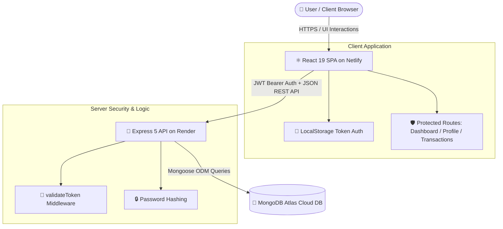

# 💰 Cashflowly — Modern Full-Stack Expense Tracker

<div align="center">

[](https://cashflowly.netlify.app/)
[](https://github.com/supritpal/Expense-Tracker)
[](https://react.dev/)
[](https://nodejs.org/)
[](https://www.mongodb.com/)
[](https://expressjs.com/)

<p align="center">
  <b>A sleek, responsive, and intuitive personal finance web application built with the MERN stack.</b><br>
  Take complete control of your finances: seamlessly track income, categorize expenditures, calculate real-time net balance, and manage your account securely.
</p>

[🚀 **Explore Live Application**](https://cashflowly.netlify.app/) • [✨ Features](#-key-features) • [🏗️ Architecture](#️-system-architecture) • [📡 API Reference](#-api-endpoints) • [💻 Local Setup](#-getting-started)

---

</div>

## 🌐 Live Deployment

| Service | Platform | URL |
| :--- | :--- | :--- |
| **Frontend Web App** | Netlify | [cashflowly.netlify.app](https://cashflowly.netlify.app/) |
| **Backend REST API** | Render | Deployed Web Service |
| **Database** | MongoDB Atlas | Cloud NoSQL Cluster |

---

## ✨ Key Features

- **📊 Real-Time Financial Dashboard**
  - Instant summary cards highlighting **Total Income**, **Total Expenses**, and **Net Balance**.
  - Dynamic calculations updating automatically on every transaction change.

- **💳 Complete Transaction Management (CRUD)**
  - **Create**: Add transactions specifying title, numerical amount, and classification (*Income* vs *Spend*).
  - **Read**: Clean, tabular view of all user entries with formatted dates and color-coded status badges.
  - **Update**: Edit existing transactions seamlessly with pre-filled inputs.
  - **Delete**: Remove obsolete entries with confirmation safeguards.

- **🔐 Robust Authentication & Security**
  - User registration & login with password encryption powered by **bcryptjs** (10 salt rounds).
  - Stateless authorization using **JSON Web Tokens (JWT)** passed via `Bearer` Authorization headers.
  - Protected client routes ensuring unauthenticated visitors cannot access sensitive financial data.
  - Automatic session cleanup and redirect upon token expiry.

- **👤 User Profile Management**
  - View logged-in account details.
  - Update personal information (Full Name and Email) directly from the profile settings.

- **🎨 Modern Glassmorphism UI**
  - Sophisticated dark mode color palette (`#0f2027` to `#2c5364`) with smooth gradients and cyan accents (`#00c6ff`).
  - Glassmorphic card styling with backdrop blur filters and elevated depth.
  - Fully responsive layout tailored for desktops, tablets, and smartphones.

---

## 🛠️ Tech Stack

### Frontend
- **Library**: [React 19](https://react.dev/)
- **Build Tool**: [Vite 7](https://vitejs.dev/)
- **Routing**: [React Router DOM v7](https://reactrouter.com/)
- **HTTP Client**: [Axios](https://axios-http.com/)
- **Iconography**: [React Icons](https://react-icons.github.io/react-icons/)
- **Styling**: Vanilla CSS (Modular custom stylesheets, Flexbox/Grid, Glassmorphic effects)

### Backend
- **Runtime**: [Node.js](https://nodejs.org/)
- **Framework**: [Express.js 5](https://expressjs.com/)
- **Database / ODM**: [MongoDB](https://www.mongodb.com/) & [Mongoose 8](https://mongoosejs.com/)
- **Security & Token**: [jsonwebtoken (JWT)](https://github.com/auth0/node-jsonwebtoken) & [bcryptjs](https://github.com/dcodeIO/bcrypt.js)
- **CORS & Environment**: [cors](https://github.com/expressjs/cors) & [dotenv](https://github.com/motdotla/dotenv)

---

## 🏗️ System Architecture



---

## 📁 Repository Structure

```text
Expense-Tracker/
├── backend/
│   ├── auth/
│   │   └── userAuth.js          # JWT sign & validation middleware
│   ├── models/
│   │   ├── transaction.js       # Transaction Mongoose schema
│   │   └── user.js              # User Mongoose schema
│   ├── routes/
│   │   ├── transactionRoute.js  # Transaction CRUD endpoints
│   │   └── userRoute.js         # Signup, Login, Profile endpoints
│   ├── .env                     # Backend environment variables
│   ├── package.json             # Backend dependencies & scripts
│   └── server.js                # Express app entrypoint & DB connection
│
├── frontend/
│   ├── public/                  # Static assets & favicon
│   ├── src/
│   │   ├── assets/              # Branding images and icons
│   │   ├── components/
│   │   │   ├── AddTransaction.jsx   # Create transaction modal/view
│   │   │   ├── EditTransaction.jsx  # Modify transaction view
│   │   │   ├── ProtectedRoute.jsx   # Auth guard component
│   │   │   └── UpdateUser.jsx       # Profile editing screen
│   │   ├── pages/
│   │   │   ├── Dashboard.jsx        # Primary financial dashboard
│   │   │   ├── Login.jsx            # User sign-in page
│   │   │   └── Signup.jsx           # Account registration page
│   │   ├── styles/                  # Dedicated CSS modules for views
│   │   ├── App.jsx                  # Main routing configuration
│   │   ├── index.css                # Global styles & resets
│   │   └── main.jsx                 # React root renderer
│   ├── .env                         # Frontend environment variables
│   ├── package.json                 # Frontend dependencies & scripts
│   └── vite.config.js               # Vite build configuration
│
└── README.md                        # Project documentation
```

---

## 📡 API Endpoints

### 🔑 Authentication & User (`/user`)

| Method | Endpoint | Description | Auth Required |
| :--- | :--- | :--- | :---: |
| `POST` | `/user/signup` | Register a new user account with hashed password | ❌ No |
| `POST` | `/user/login` | Authenticate credentials and receive JWT | ❌ No |
| `GET` | `/user/me` | Retrieve profile of the logged-in user | ✅ Yes |
| `PUT` | `/user/update` | Update full name and email address | ✅ Yes |

### 💵 Transactions (`/transaction`)

| Method | Endpoint | Description | Auth Required |
| :--- | :--- | :--- | :---: |
| `GET` | `/transaction/` | Fetch all transactions for authenticated user | ✅ Yes |
| `GET` | `/transaction/:id` | Fetch specific transaction by ID | ✅ Yes |
| `POST` | `/transaction/add` | Create a new transaction (`income` or `spend`) | ✅ Yes |
| `PUT` | `/transaction/:id` | Update an existing transaction record | ✅ Yes |
| `DELETE` | `/transaction/:id`| Permanently delete a transaction | ✅ Yes |

---

## 💻 Getting Started

Follow these steps to run the application locally on your machine.

### Prerequisites

- [Node.js](https://nodejs.org/) (v18.0.0 or higher recommended)
- [npm](https://www.npmjs.com/) or [yarn](https://yarnpkg.com/)
- A free [MongoDB Atlas](https://www.mongodb.com/cloud/atlas) cluster or local MongoDB instance

---

### 1. Clone the Repository

```bash
git clone https://github.com/supritpal/Expense-Tracker.git
cd Expense-Tracker
```

---

### 2. Backend Setup

1. Navigate to the backend directory:
   ```bash
   cd backend
   ```
2. Install dependencies:
   ```bash
   npm install
   ```
3. Create a `.env` file in the `backend/` directory:
   ```env
   PORT=3500
   MONGO_URL=your_mongodb_connection_string
   secret=your_jwt_secret_key
   ```
4. Start the backend server:
   ```bash
   # Development mode with nodemon
   npm run dev

   # Or standard production mode
   npm start
   ```
   *The backend will be running at:* `http://localhost:3500`

---

### 3. Frontend Setup

1. Open a new terminal window and navigate to the frontend directory:
   ```bash
   cd frontend
   ```
2. Install dependencies:
   ```bash
   npm install
   ```
3. Create a `.env` file in the `frontend/` directory:
   ```env
   VITE_API_URL=http://localhost:3500
   ```
   *(For production, point `VITE_API_URL` to your deployed backend URL on Render)*

4. Start the Vite development server:
   ```bash
   npm run dev
   ```
   *The client will launch at:* `http://localhost:5173`

---

## 🧪 Environment Variables Summary

### Backend (`backend/.env`)

| Variable | Description | Example |
| :--- | :--- | :--- |
| `PORT` | Port number for the Express server | `3500` |
| `MONGO_URL` | MongoDB connection URI string | `mongodb+srv://<user>:<password>@cluster.mongodb.net/dbname` |
| `secret` | Secret key for signing and verifying JWTs | `your_super_secret_jwt_key` |

### Frontend (`frontend/.env`)

| Variable | Description | Example |
| :--- | :--- | :--- |
| `VITE_API_URL` | Base URL of the backend REST API | `http://localhost:3500` *(Local)* or `https://expense-tracker-l7e1.onrender.com` *(Prod)* |

---

## 🗺️ Roadmap & Future Enhancements

- [ ] **Interactive Visualizations**: Graphical spending insights with Chart.js / Recharts.
- [ ] **Data Export**: Export transaction records to CSV, Excel, and PDF formats.
- [ ] **Budgeting & Alerts**: Monthly category-based budget caps with threshold alerts.
- [ ] **Recurring Transactions**: Automated scheduled entry for subscriptions and salaries.
- [ ] **Multi-Currency Support**: Dynamic currency switching with live exchange rate integration.

---

## 🤝 Contributing

Contributions, issues, and feature requests are welcome!

1. Fork the Project
2. Create your Feature Branch (`git checkout -b feature/AmazingFeature`)
3. Commit your Changes (`git commit -m 'Add some AmazingFeature'`)
4. Push to the Branch (`git push origin feature/AmazingFeature`)
5. Open a Pull Request

---

## 📄 License

This project is open-source and available under the [ISC License](LICENSE).

---

## 👨‍💻 Author

**Suprit Pal**

- **GitHub**: [@supritpal](https://github.com/supritpal)
- **Live App**: [Cashflowly](https://cashflowly.netlify.app/)

<div align="center">
  <sub>Built with ❤️ using the MERN Stack. If you found this project helpful, please consider giving it a ⭐ on GitHub!</sub>
</div>